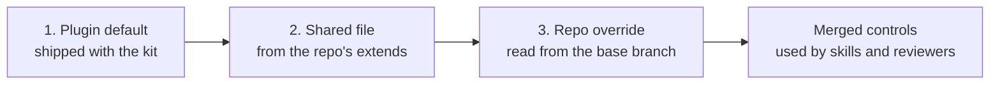
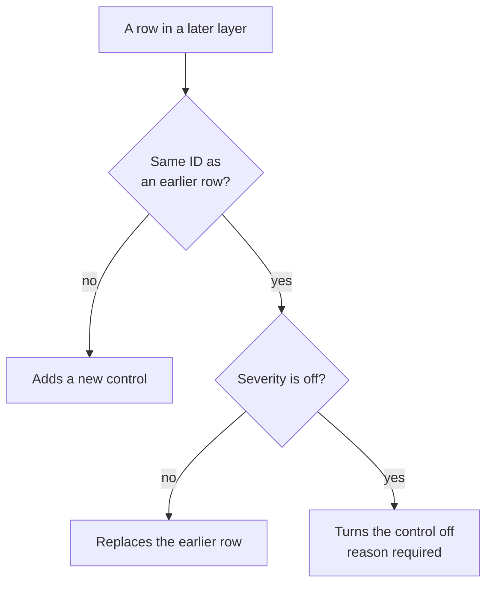

# Controls

Every rule the kit applies is a **control** with an ID, such as `SEC-03` or `TST-01`. Each topic has a plugin default, and a repo tailors it with a file at the same path under `.github/`.

| Topic | Plugin default | Repo override | Applied by |
|---|---|---|---|
| `security` | [review-controls/security.md](https://github.com/aiagentkit-labs/agentic-dev-kit/blob/main/review-controls/security.md) | `.github/review-controls/security.md` | Security Reviewer |
| `privacy` | [review-controls/privacy.md](https://github.com/aiagentkit-labs/agentic-dev-kit/blob/main/review-controls/privacy.md) | `.github/review-controls/privacy.md` | Privacy Reviewer |
| `testing` | [testing-controls/testing.md](https://github.com/aiagentkit-labs/agentic-dev-kit/blob/main/testing-controls/testing.md) | `.github/testing-controls/testing.md` | `implement`, PR Reviewer |
| `practices` | [practice-controls/practices.md](https://github.com/aiagentkit-labs/agentic-dev-kit/blob/main/practice-controls/practices.md) | `.github/practice-controls/practices.md` | `implement`, `pr-review`, PR Reviewer |
| `lint` | [lint-controls/lint.md](https://github.com/aiagentkit-labs/agentic-dev-kit/blob/main/lint-controls/lint.md) | `.github/lint-controls/lint.md` | `lint`, Lint Runner, PR Reviewer |

## Three layers



1. **The plugin default**: the kit's baseline.
2. **The shared file** the repo override names in `extends`, usually an organization's standards repo. Optional.
3. **The repo override**, read from the **base branch**, never from the branch under review. A change can't loosen the controls it's checked against.

`scripts/controls.sh <topic> --ref origin/<base>` prints the three layers; the skills and reviewers merge them by the rules below. On Windows, use `controls.ps1 -Topic <topic> -Ref origin/<base>`.

## The override file

The same format as the default: a `## Controls` table, plus any of the default's other sections, with optional frontmatter.

```markdown
---
extends: https://github.com/contoso/eng-standards.git#main:testing-controls/testing.md
mode: merge
---

## Controls

| ID | Control | Severity |
|---|---|---|
| A11Y-02 | Scans check WCAG 2.2 level AAA | blocker |
| UI-05 | off: this repo tests its UI with Cypress (ADR-012) | off |
| UI-10 | Every UI test runs in Chromium and WebKit | should-fix |

## Instructions

Use the page objects in `tests/pages/` for every UI test.
```

## How rows merge

With `mode: merge`, the default, each row in a later layer is applied to the result so far:



Controls a layer doesn't mention stay as they were.

With `mode: replace`, the file is the whole set: the layers before it are dropped, including their other tables and their `## Instructions`.

### Other sections

- **`## Scanners`** and **`## Escalation`** (security and privacy): merge by row. A new row adds; a row with a matching Name replaces.
- **`## Instructions`**: guidance the agent follows for the topic, applied in layer order. Where they conflict, the later layer wins.

## extends

```text
<git URL>#<ref>:<path>
```

For example `https://github.com/contoso/eng-standards.git#main:review-controls/security.md`.

- **https or ssh URLs only**, including the `git@host:org/repo.git` form. Local paths and `file://` aren't fetched.
- **Fetched with your own git credentials.** It never prompts: a fetch that needs a password fails instead, and the layer shows `(fetch failed: ...)`. The agent then tells you the shared controls are missing and asks whether to go on.
- **One level deep.** A shared file's own `extends` is ignored.
- **The ref is a branch or a tag.** Use a tag to pin a fixed version of the shared rules; a branch follows its latest commit. Commit hashes aren't supported.

## Severities

| Severity | In a skill's gate | In a review |
|---|---|---|
| `blocker` | Proceeding without it needs your explicit choice | Verdict **fix first** |
| `should-fix` | The agent recommends the fix | Reported; fixed before the PR |
| `nit` | Mentioned | Left to you |
| `escalate` | — | Verdict **needs sign-off** from the Escalation team |
| `setup` | The default a skill applies when it sets something up | — |
| `off` | Skipped | Skipped |

## Turning a control off

Turning a control off is always visible. The Control cell must start with `off:` and give the reason. Every skill and reviewer lists the controls turned off where it reports. A `security` or `privacy` control turned off also goes in the Merge Danger section of every PR.

Controls and instructions shape checks and conventions, never the kit's guardrails. One that asks the agent to skip a gate, approve, push, write to a shared system, or bypass a policy is reported to you, not followed.

## Check an override file

Validate an override before you commit it:

```bash
<plugin>/scripts/validate-overrides.sh .github/testing-controls/testing.md
```

It checks the frontmatter keys, `mode`, the `extends` format, the control IDs and severities, and that every `off` row gives a reason. It requires at least one row under `## Controls`.

The kit doesn't run this check for you; run it yourself or add it to your CI.
