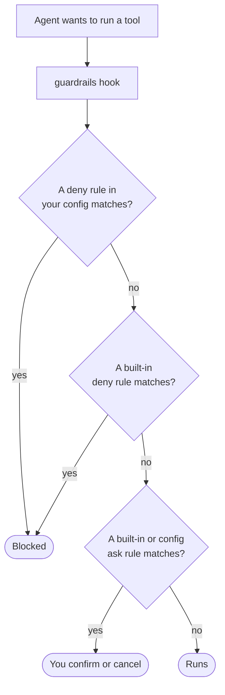

# Guardrails

The skills' instructions guide the agent; they don't stop it. Guardrails do. There are three layers:

1. **Read-only reviewers.** The PR, Security, and Privacy reviewers have only read and search tools.
2. **The guardrails hook.** A `PreToolUse` hook checks every tool call before it runs, while the plugin is enabled.
3. **Your repository's own policies.** Branch protection, required reviewers, and least-privilege tokens: the only layer that holds when everything else fails.

This page is about the hook.

## What the hook decides

For each tool call, the hook returns one of three outcomes:

- **deny**: the call is blocked, with the reason.
- **ask**: VS Code asks you to confirm or cancel.
- **nothing**: the call runs.



When several hooks are installed, VS Code applies the most restrictive answer: deny beats ask, and ask beats allow.

## Built-in rules

**Denied:**

- `git push --force`, `-f`, or a `+refspec`
- Pushing directly to `main`, `master`, `develop`, or `release/*`
- `git reset --hard`, `git clean -f`, `git branch -D`
- `git checkout .` and `git restore .`
- `git stash drop` and `git stash clear`
- `--no-verify`, and bypassing branch policies

**Asked about:**

- Any other `git push`, including `--force-with-lease`
- `gh pr` writes, `gh api` writes, and GraphQL mutations
- `az repos pr`, `az repos policy`, and `az boards` writes, and `az devops invoke` writes
- Every Azure DevOps MCP tool that writes
- Recursive deletes, except the kit's own temp folder under `.git/agentic-dev-kit/`

## Add your own rules

Create `.github/guardrails/guardrails.yaml` in your repo. The hook also accepts `guardrails.yml`, `config.yaml`, or `config.yml` in the same folder.

```yaml
extends: https://github.com/contoso/eng-standards.git#main:guardrails/guardrails.yaml
deny:
  - terraform destroy
  - '\bdrop table\b'
ask:
  - kubectl apply
```

- **`deny`** and **`ask`**: lists of patterns. Each is a regular expression matched case-insensitively anywhere in the command, so `git push` also matches inside `legit push`. Use `\b` for word boundaries or `^` to anchor to the start.
- **`extends`** (optional): a shared rules file, in the same `<git URL>#<ref>:<path>` format as [controls](controls.md#extends). Its rules are added first. https and ssh URLs only, one level deep.
- **`mode`** (optional): `merge`, the default, adds your rules to the plugin's and the shared file's config rules. `replace` keeps only yours. Neither touches the built-in rules.

### What your rules can and can't change

- **They can only tighten.** A `deny` rule blocks a command the built-ins would allow or ask about. An `ask` rule adds a prompt where the built-ins would allow. Neither can turn a built-in deny into ask or allow.
- **A broken file is ignored as a whole.** An unknown `mode`, a malformed `extends`, or an unexpected line means the file isn't used, and the built-in rules still apply.
- **The file is read from your working tree**, not the base branch. That's safe because the file can only add restrictions.

## Limits to know

- **Windows:** `guardrails.ps1` applies only the built-in rules. It doesn't read `.github/guardrails/` or `extends` yet.
- **Python:** your rules are evaluated by `scripts/policy_loader.py`. Without `python3`, the hook skips them and applies only the built-in rules.
- **extends and speed:** with `extends` set, the hook fetches the shared file on every tool call, which adds a network round trip to each call.
- **No script found:** if the hook can't find its script, it lets tool calls through and prints a warning, because Copilot denies every tool call when a `PreToolUse` hook errors.

## Check it yourself

From the plugin folder:

```bash
bash scripts/guardrails.test.sh
bash scripts/guardrails-config.test.sh
```

The first suite covers the built-in rules; the second covers repo config, `extends`, and the rule that config can't loosen a built-in deny.
