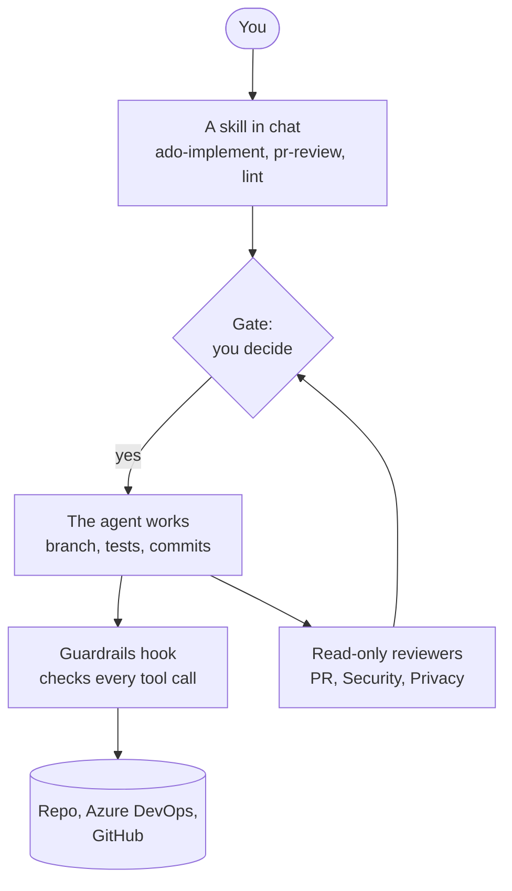

# agentic-dev-kit

An [Agent Plugin](https://agent-plugins.org/) for GitHub Copilot in VS Code that takes Azure DevOps work items to tested, reviewed pull requests. It interviews you at every step, and nothing is pushed or written to a shared system without your yes.

## How it fits together

Each skill works in rounds. At every gate the agent shows what it found and what it recommends, and you choose. Before the pull request, three read-only reviewers check the change in parallel against your **controls**: the rules for security, privacy, testing, practices, and lint. A **guardrails** hook runs before every tool call, blocking destructive commands and asking before anything writes to a shared system.

## Skills

| Skill | What it does |
|---|---|
| `ado-implement` | Takes a work item to a pull request: assess the item, settle scope, branch, test-first, commit, review, open the PR |
| `pr-review` | Works a pull request from either side: address the comments on yours, or review someone else's |
| `lint` | Runs and fixes the repo's linters and formatters on the files you touched, and sets up a baseline where there is none |
| `branch-policies` | Reads and sets branch policies with a **team** or **solo** profile |
| `pr` | Writes a PR body: summary, before and after evidence, merge danger |
| `grilling`, `grill-me` | Stress-test a plan or decision with rounds of questions |
| `teach` | Teaches a new concept inside your workspace |

## Reviewers

| Agent | Checks against |
|---|---|
| PR Reviewer | The work item's acceptance criteria, the test layers, and the testing, practices, and lint controls |
| Security Reviewer | The security controls, plus your organization's |
| Privacy Reviewer | The privacy controls, plus your organization's |
| Lint Runner | Runs the repo's linters in check mode and groups the findings |

All four can't edit files or write to anything. The three reviewers can only read and search; the Lint Runner can also run commands, because it runs your linters in check mode.

## Where to next

- [Getting started](getting-started.md): install the plugin and turn on the guardrails.
- [Workflows](workflows.md): each skill, step by step.
- [Controls](controls.md): how a repo or an organization tailors the rules.
- [Recipes](recipes.md): copy-paste overrides for common needs.
- [Guardrails](guardrails.md): what the hook blocks, what it asks about, and how to add your own rules.
