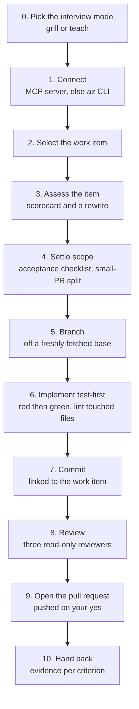
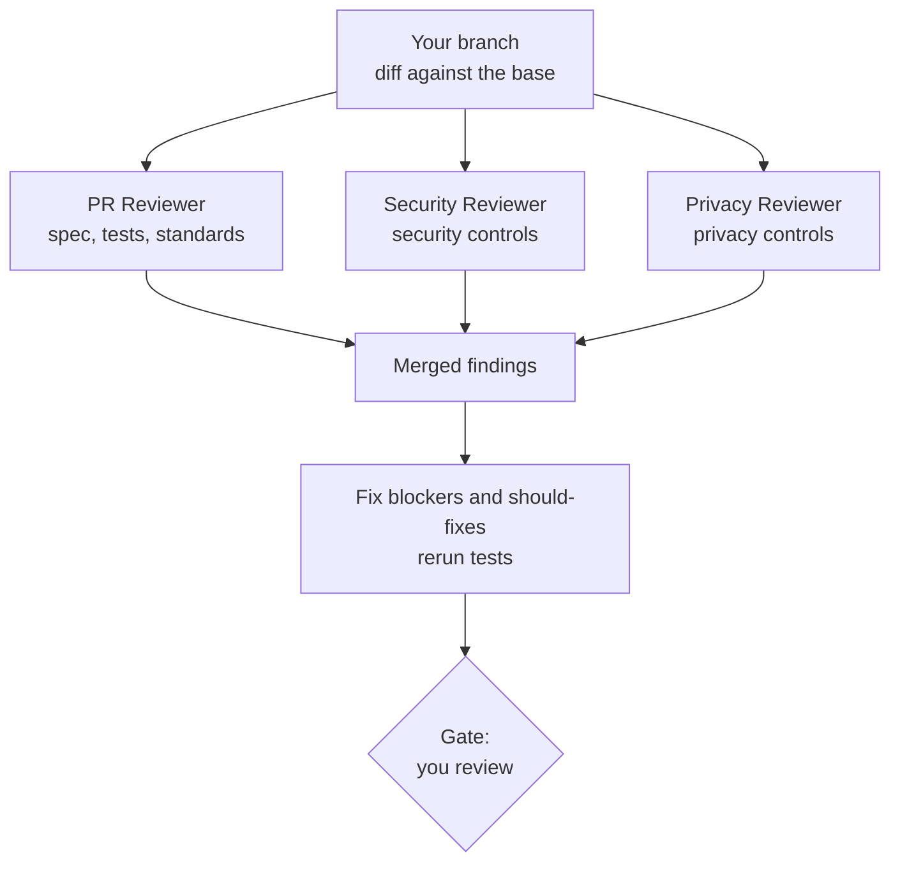
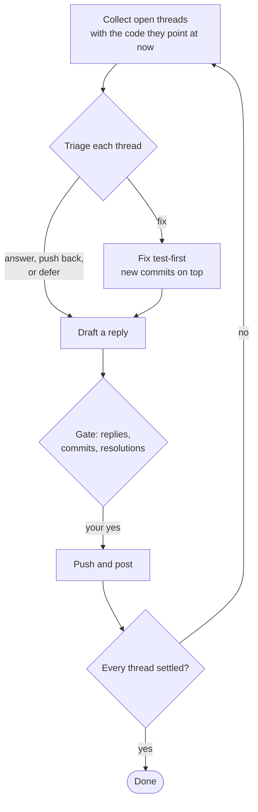
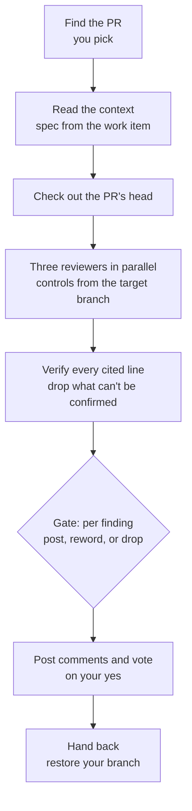
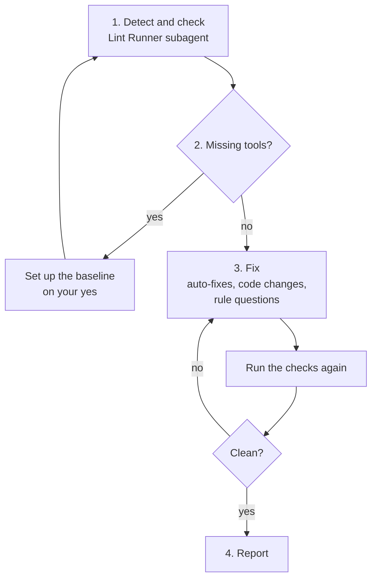
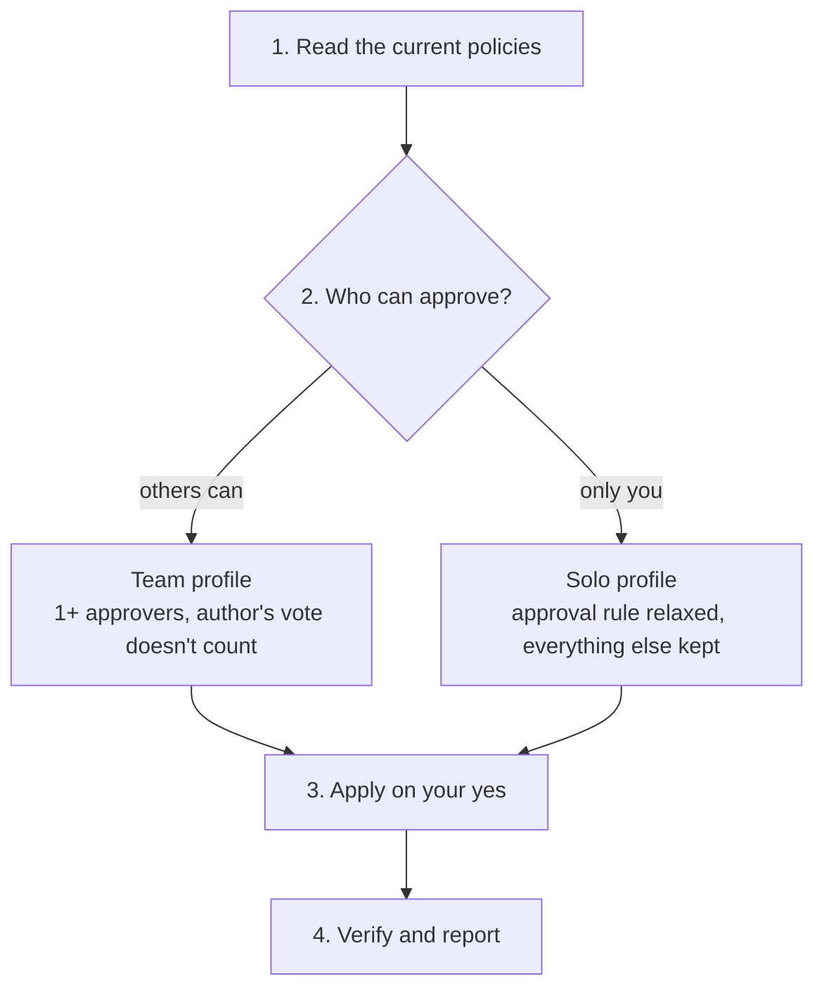

# Workflows

Every skill works the same way: it gathers facts itself, then stops at a **gate** where you decide. Nothing is pushed, posted, or written to Azure DevOps or GitHub without your yes.

## ado-implement: work item to pull request

| Step | Gate: what you decide |
|---|---|
| 2. Select | Which item to work on. Several items run one at a time, one branch and PR each. |
| 3. Assess | The rewritten item: every gap filled with a default marked as an assumption, which you accept or amend |
| 4. Settle scope | The acceptance checklist, each entry with the check that proves it, and any split into smaller PRs |
| 5. Branch | The base branch and the new branch's name |
| 6. Implement | The test plan: the layer, seam, and test name for each checklist entry, and any new packages |
| 7. Commit | The staged files and the commit message |
| 8. Review | The merged findings, the fixes made, which nits to take, and any `escalate` findings |
| 9. Pull request | Title, target, draft or not, reviewers, merge strategy, and the full body |
| 10. Hand back | Which Azure DevOps updates to make: state change, comment with the PR link |

### Step 8: the review

The three reviewers run in parallel, each starting with an empty context. Each gets the work item, the acceptance checklist with its evidence, the full diff, and its [controls](controls.md), read from the base branch, so the change under review can't rewrite them. Reviewers that reported blockers run again until none remain.

When nobody else can approve your PRs, the **solo** profile from `branch-policies` applies, and `ado-implement` posts the reviewers' findings on the PR as its review record.

## pr-review: address the comments on your PR

A thread is **settled** when it's resolved, or holds your reply and waits on the reviewer. A pushed-back thread stays open for the reviewer to resolve; a deferred one becomes a follow-up work item.

## pr-review: review someone else's PR

The recommended vote follows from the findings: any blocker means *request changes* (*wait for author* on Azure Repos), and an `escalate` finding adds its sign-off team as a reviewer.

## lint: the files you touched

The scope is the files changed against the base branch plus your uncommitted ones. The Lint Runner keeps long lint output in its own context, so your chat only sees the grouped findings.

## branch-policies: team or solo

**Solo** relaxes only who approves. Pull requests, builds, resolved comments, and blocked force pushes stay required. In return, the reviewers' findings become the PR's review record, and you acknowledge each `escalate` finding in a PR comment.
